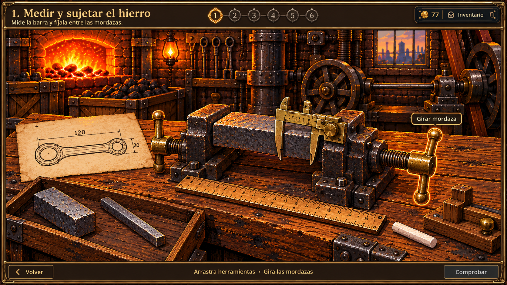
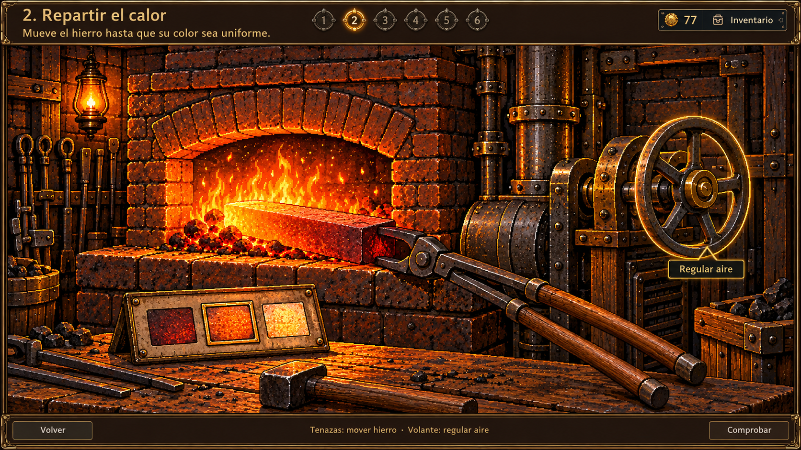
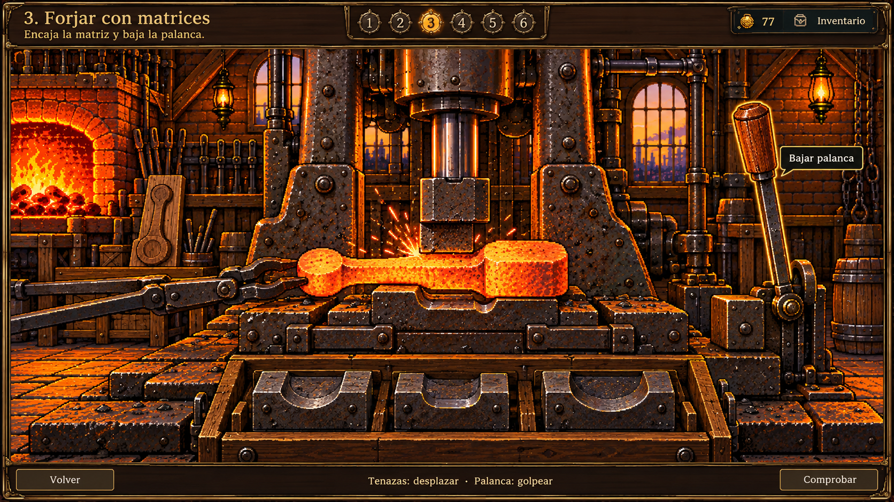
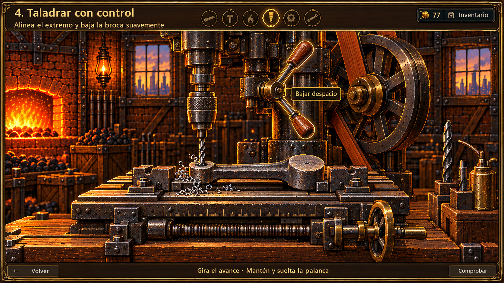
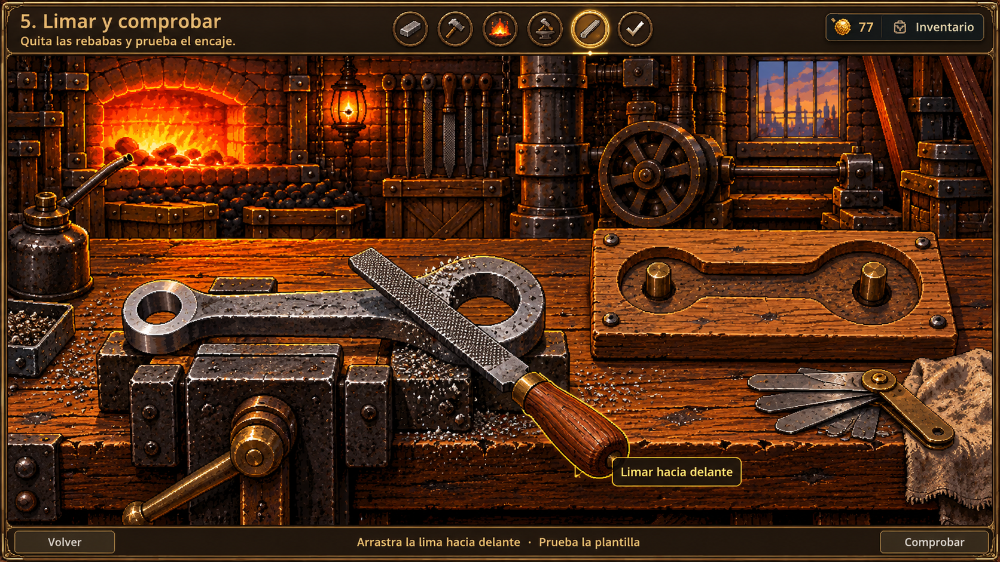
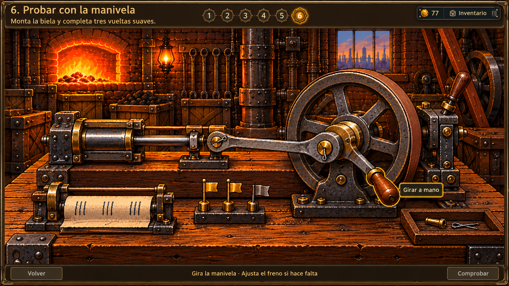

# Cort: seis fases para trabajar con las herramientas

Propuesta visual del 10 de octubre de 2026, generada con **image_gen integrado**. Contiene seis conceptos nuevos para revisar, sin cambios al código ni al guardado del juego. Los fondos actuales se usan como referencia de estilo y continuidad; las imágenes no son capturas de funciones implementadas.

## Referencia del carretero

Se revisaron `scripts/ui/wheelwright_forge_popup.gd`, `forge_challenge_tools.gd`, `forge_workbench_display.gd` y su prueba de seis etapas. Allí el jugador orienta piezas, aprieta mordazas, controla el calor, alinea remaches, ajusta tornillos y prueba el giro bajo carga. El principio que se propone trasladar a Cort es que cada herramienta tenga un movimiento, una consecuencia visible y una comprobación comprensible.

La mejora no depende de sumar clics. En el taller actual varias acciones eligen un estado discreto o disparan una animación automática; la propuesta permite observar la pieza, manipular las herramientas y corregir su posición o ajuste.

## 1. Medir y sujetar el hierro

Arrastra una de las tres barras al banco. Compara su largo con una regla física y su grosor cerrando las mordazas de un calibre. El pedido de Cort muestra la forma de la biela; las barras no llevan etiquetas que revelen cuál es la respuesta. Después gira las dos manivelas del soporte para sujetarla.

- La regla se mueve sobre la mesa y el calibre abre y cierra sus mandíbulas.
- Una barra corta deja un hueco; una fina no coincide con la abertura de referencia. Se puede cambiar libremente antes de comprobar.
- Cada mordaza mueve su tornillo y deja de vibrar la barra al quedar fija. Solo se aprieta lo necesario, sin exigir un gesto circular perfecto.
- Se aprueba al coincidir ambas medidas y asegurar la pieza. Las cifras del dibujo son ilustrativas; las medidas definitivas deben concordar con la escala de las piezas al implementarlo.

## 2. Repartir el calor

Toma la barra con las tenazas e introdúcela en el horno. Desplázala a izquierda y derecha para que los extremos y el centro alcancen un naranja uniforme; gira el volante para subir o bajar el aire. La barra permanece sólida.

- El extremo más próximo al fuego se calienta antes; la posición de las tenazas cambia qué zona recibe más calor.
- La llama responde al aire; el hierro cambia progresivamente de oscuro a rojo, naranja y demasiado claro.
- Una pequeña referencia de colores, acompañada de señales de estado, sustituye el porcentaje como ayuda principal. Cort puede explicar «el extremo sigue frío».
- Se aprueba cuando las tres zonas permanecen listas durante un breve intervalo y el jugador retira la barra. Fácil deja una franja amplia y tiempo para corregir; no exige regular aire y tenazas simultáneamente con precisión.

## 3. Forjar con matrices

Arrastra la matriz apropiada al yunque, desliza el hierro con las tenazas hasta el tope y baja la palanca del martillo. Trabaja el ojo pequeño, el cuello y el ojo grande. La pieza comienza como una barra y adquiere su forma localmente con cada impacto aceptado.

- Las tres matrices muestran huecos distintos; se comparan por su forma con el modelo de madera.
- La palanca recorre un arco real, el pistón baja y el martillo golpea exactamente la zona colocada debajo. Hay escamas, un breve destello, sonido y una pequeña vibración del banco.
- Los topes ayudan a alinear la pieza. La palanca debe regresar antes del siguiente golpe: se evita resolverlo pulsando repetidamente.
- Dos golpes por zona siguen siendo suficientes; la matriz equivocada o la mala alineación se señalan antes de confirmar un golpe. Los extremos siguen macizos hasta el taladrado.

## 4. Taladrar con control

Fija la biela, gira el tornillo de avance para llevar la marca de uno de sus extremos bajo la broca y monta la broca que corresponde a su diámetro. Mantén y suelta la palanca para bajar y levantar el cabezal.

- El volante mueve la mesa y las mordazas junto con la pieza; los topes facilitan la alineación.
- La correa, la polea y la broca giran. El agujero crece a medida que entra la broca y aparecen virutas pequeñas.
- Si se baja demasiado deprisa aumenta la vibración y el sonido: aflojar la palanca permite recuperar el control. No se añade una misión de recoger lubricante; la aceitera es un recurso del banco.
- Se aprueba al perforar ambos ojos con sus diámetros y retirar la broca. Un extremo terminado se conserva si hay que corregir el otro.

## 5. Limar y comprobar

La pieza ya fría queda sujeta en un tornillo de banco. Arrastra la lima hacia delante sobre las rebabas que se ven en el metal; volver atrás recoloca la herramienta. Después levanta la biela y encájala en la plantilla de madera con dos pasadores.

- Se ven bordes irregulares, pequeñas limaduras que caen y un bisel limpio en las zonas terminadas. La imagen del metal cambia en cada pasada útil.
- Un primer plano breve ayuda a encontrar una rebaba que impide el ajuste. No basta con repetir clics lejos de la pieza.
- La plantilla comparte escala y orientación con la biela: el ojo pequeño y el grande encajan en sus respectivos apoyos. Si aún roza, esa zona queda señalada y se vuelve a limar.
- Se aprueba con la superficie terminada y la pieza asentada. No se introduce templado brusco en agua para esta biela de hierro trabajado.

## 6. Probar con la manivela

Monta la biela entre la guía del pistón y el punto excéntrico del volante. Coloca y asegura los dos pasadores. Gira la manivela con un gesto circular para completar tres vueltas: el desplazamiento del pistón y el giro del volante deben corresponderse.

- El mecanismo tiene un tamaño coherente, apoyos y uniones visibles. La biela no aparece como una pieza enorme que flota delante del volante.
- El movimiento sigue la mano: al dejar de girar pierde velocidad suavemente. Hay una alternativa de teclado de mantener y soltar, sin exigir arrastres circulares exactos.
- Las primeras vueltas comprueban el recorrido libre y la última añade una resistencia ligera mediante un freno de cuero. El jugador puede aflojarlo si se atasca; no hace falta acertar una velocidad exacta.
- Tres pequeñas banderas marcan las comprobaciones aceptadas. La tira de papel del concepto es una visualización opcional del vaivén, no una tarea adicional.
- Se entrega la biela solo al completar la prueba manual; desaparece la espera automática de cinco segundos como mecánica principal.

## Interfaz común y continuidad

La zona de trabajo ocuparía casi todo el panel. Arriba quedarían título, una instrucción, seis marcas de avance y el HUD habitual. Se sustituirían los párrafos laterales y las filas de botones por herramientas tocables y una indicación breve al acercar el cursor o seleccionar. «Volver» y «Comprobar» seguirían accesibles; las explicaciones largas de Cort se consultarían como ayuda.

Ratón, toque y teclado permitirían las mismas acciones. Fácil ofrecería topes, encaje asistido y tolerancias amplias; Difícil reduciría la ayuda y pediría ajustes más finos sin añadir tareas repetitivas. Mover una herramienta o explorar un ajuste no gastaría oportunidades; los fallos se confirmarían al ejecutar una operación inválida. Se conservarían las fases aprobadas, la pausa, la continuación y el presupuesto compartido.

La fundición seguiría aportando hierro y combustible. La recompensa continuaría siendo una sola biela para Murdoch. Los costales del jugador se reservarían para la caldera y su misión independiente de mantener presión durante **120 segundos**.

## Entregables

Las seis imágenes anteriores son propuestas estáticas de interacción y aspecto; sus animaciones, tolerancias, sonidos y controles se construirían tras elegir el rediseño. No se han sustituido recursos de producción ni aplicado estas mecánicas al juego.

Los [prompts exactos, referencias y archivos originales](prompts_v1.json) documentan las seis llamadas al generador integrado. Se conservaron las imágenes originales y se copiaron estas propuestas a la carpeta del proyecto.
